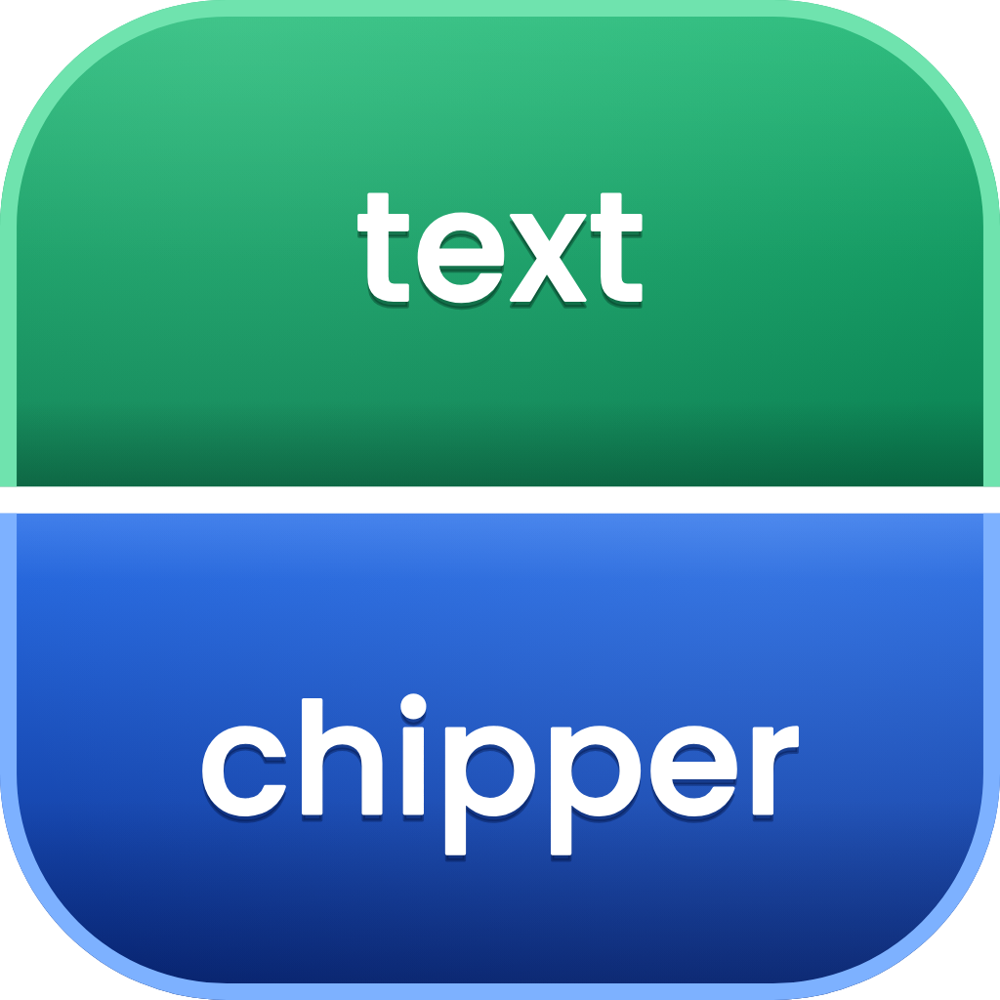
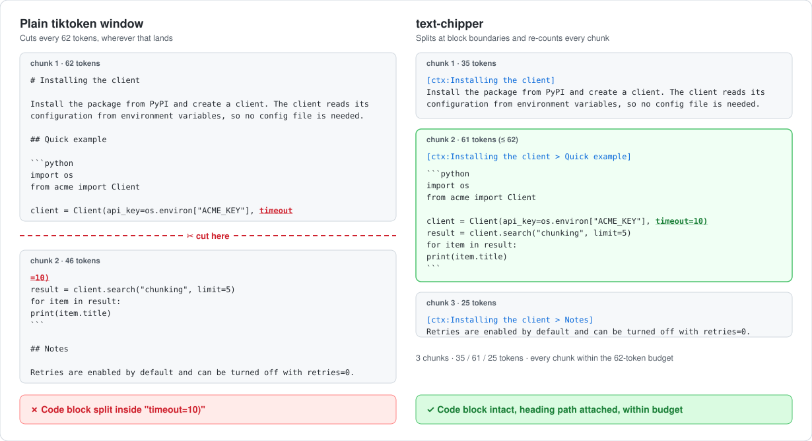
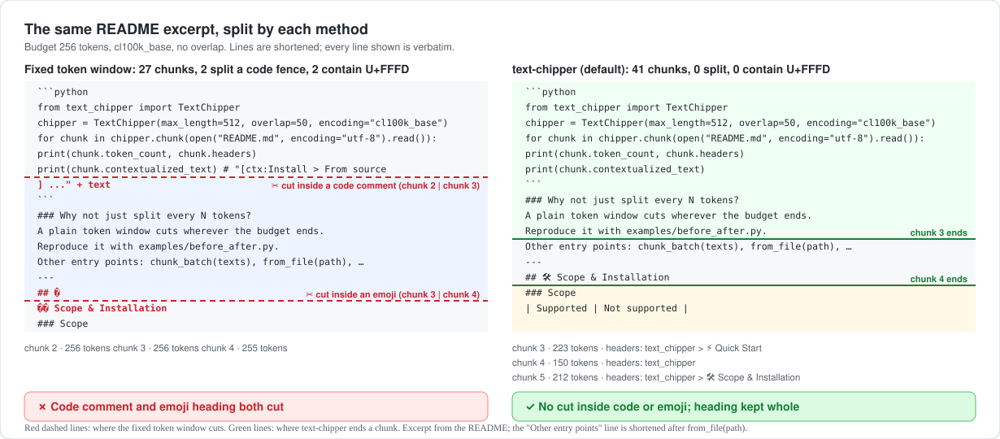
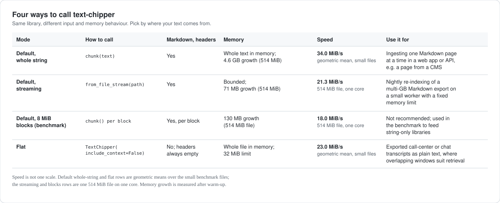
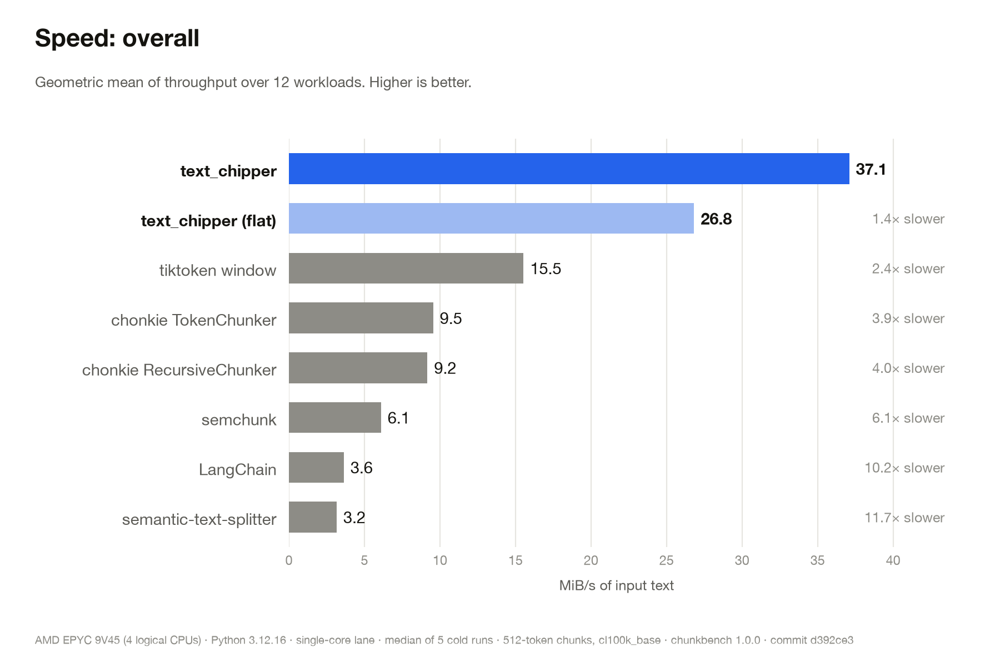
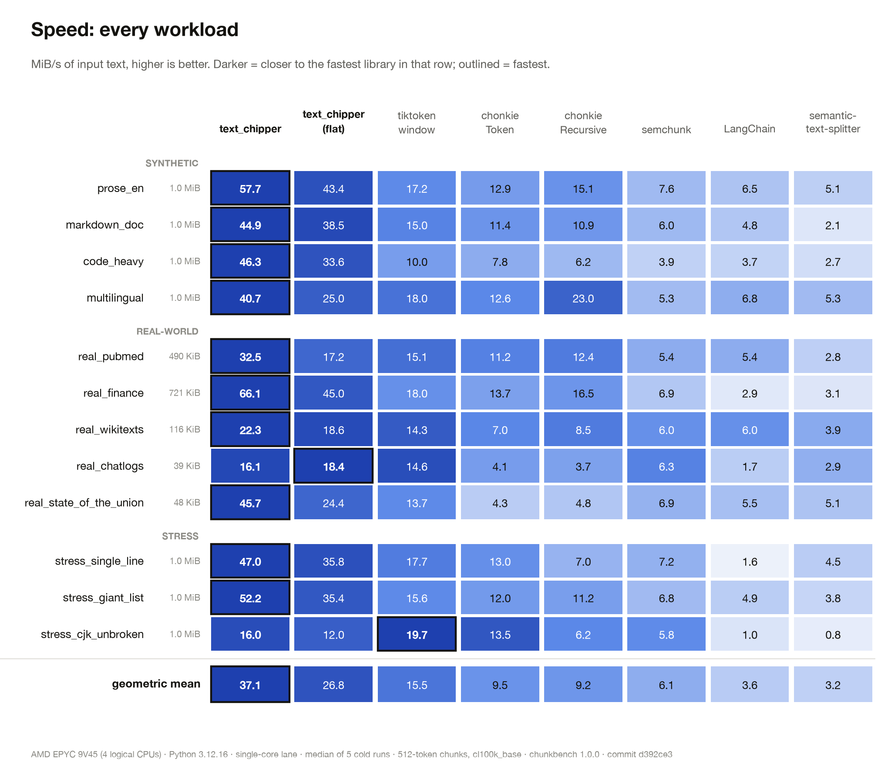
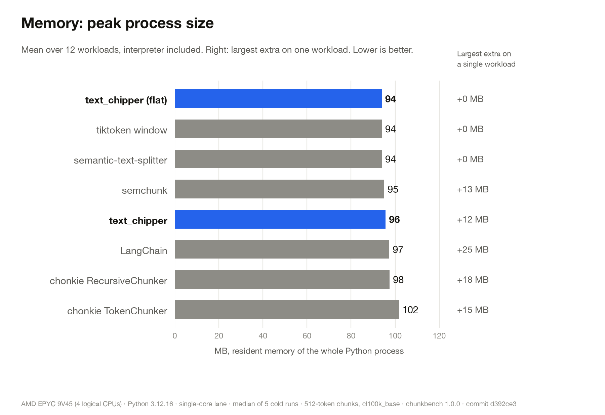
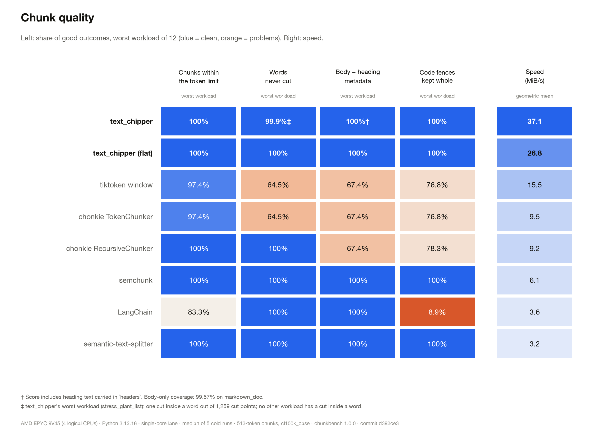
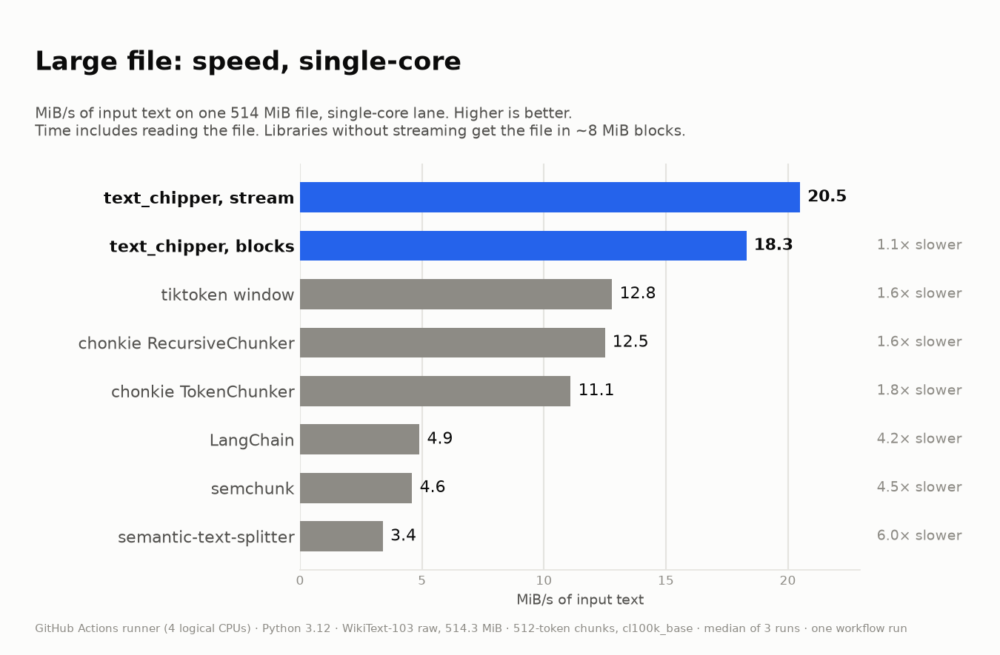
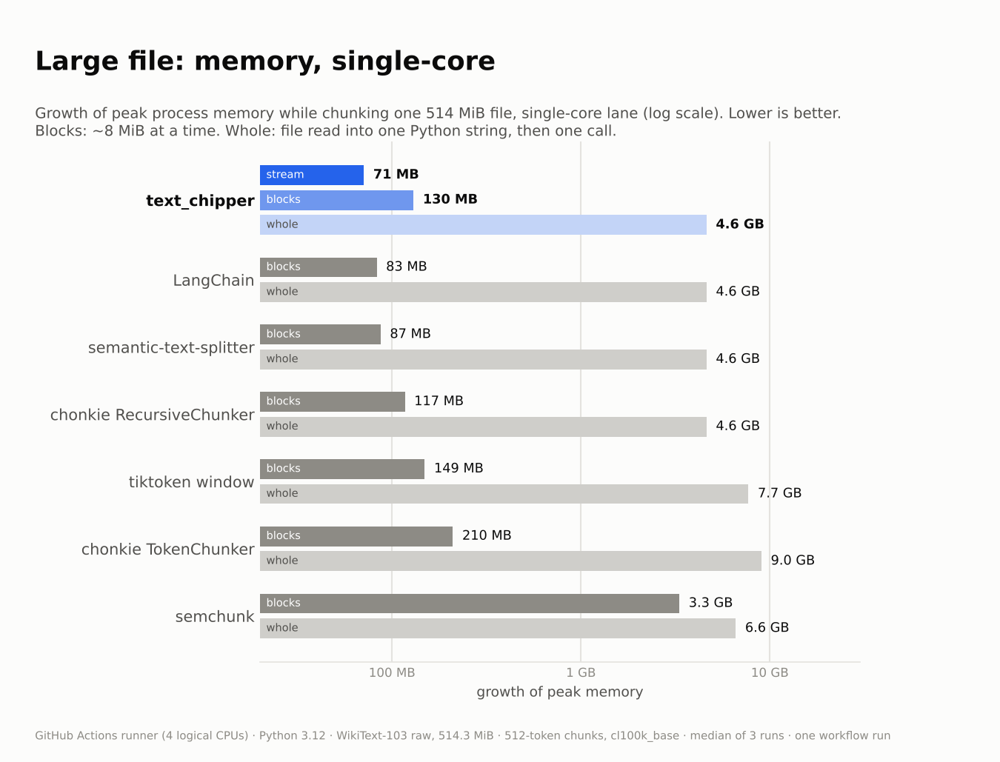

# text_chipper



**High-performance, Markdown-aware, strictly budget-enforced text chunking for RAG and LLM pipelines.
Built in Rust with Python bindings.**

[](https://www.rust-lang.org/)
[](https://www.python.org/)
[](LICENSE)
[](https://crates.io/crates/text_chipper)
[](https://docs.rs/text_chipper)
[](https://pypi.org/project/text-chipper/)

<br clear="left">

- **Token-exact budget.** In the default strict mode every chunk is re-tokenized exactly as it
  will be delivered (header context included), so `token_count <= max_length` always holds for the
  tokenizer you configure, and with [guard tokenizers](#other-tokenizers-and-guards) for every
  tokenizer you list.
- **Structure-aware.** Text is divided at blank lines into blocks that are packed into chunks and
  split internally only when a block does not fit. Fenced code blocks and list items are kept
  intact when they fit, and headings become `headers` metadata for each chunk. See
  [Markdown support](#markdown-support-and-commonmark-conformance) for exactly what is and is
  not recognized.
- **Never cuts inside a grapheme cluster** (emoji sequences, combining marks).
- **Offsets map back to your input**, even when Unicode normalization (NFC/NFKC) is applied.

- Block boundaries are compared against `pulldown-cmark` on the CommonMark 0.31.2 spec corpus
  (results and limits below); there are also property tests and a robustness suite. This is a
  chunker, not a complete CommonMark parser.

---

## ⚡ Quick Start

### Python

Install the Python package from PyPI:

```bash
pip install text-chipper
```

Then split a Markdown file:

```python
from text_chipper import TextChipper

chipper = TextChipper(max_length=512, overlap=50, encoding="cl100k_base")

with open("README.md", encoding="utf-8") as file:
    for chunk in chipper.chunk(file.read()):
        print(chunk.token_count, chunk.headers)   # e.g. 487 ['Install', 'From source']
        print(chunk.contextualized_text)          # "[ctx:Install > From source] ..." + text
```

Other Python entry points include `chunk_batch(texts)`, `from_file(path)`, `from_files(paths)`,
`from_file_stream(path)` (an iterator), and `count_tokens(text)`. Each `TextChunk` also carries
character and byte offsets in normalized and original input. Adapters for LangChain and LlamaIndex
are in [`integrations/`](integrations/).

### Rust

You need a Rust toolchain. Create a project and add the crate from crates.io:

```bash
cargo new my_chunker
cd my_chunker
cargo add text_chipper
```

Replace `src/main.rs` with this example, then run `cargo run`:

```rust
use text_chipper::{smart_chunk, Backend, ChunkConfig};

fn main() -> Result<(), text_chipper::ChipError> {
    let backend = Backend::from_name("cl100k_base")?;
    let cfg = ChunkConfig {
        max_tokens: 512,
        overlap_tokens: 50,
        ..Default::default()
    };
    let text = "## Retry configuration\n\nThe client retries failed requests up to three times.";

    for chunk in smart_chunk(text, &cfg, &backend)? {
        println!("{} {:?}", chunk.token_count, chunk.headers);
        println!("{}", chunk.contextualized_text());
    }
    Ok(())
}
```

The Rust crate is published on crates.io as `text_chipper` (with an underscore). The Python
package is separate and uses `pip install text-chipper` (with a hyphen). The Rust crate has no
runtime dependency on Python or PyO3 and installs no global allocator by default. Optional Cargo
features include `mimalloc` (global allocator), `hf` (Hugging Face `tokenizer.json` support), and
`python` (the extension used for the PyPI wheel). PyPI wheels include both `python` and `hf`. See the
[API documentation](https://docs.rs/text_chipper) for offsets, streaming (`FileChunker`) and
custom tokenizers.

## Why not just split every N tokens?

A plain token window cuts wherever the budget ends. On Markdown, that can split a code block in
the middle of a line. Same input, same budget (`max_length = 62`, kept small so it fits on a
screen):



Reproduce it with [`examples/before_after.py`](https://github.com/kameh0use/text-chipper/blob/main/examples/before_after.py).

The same comparison on a real README excerpt: the fixed token window on the left, text-chipper
on the right. [`benchmarks/before_after_readme.py`](https://github.com/kameh0use/text-chipper/blob/main/benchmarks/before_after_readme.py) runs it on
any Markdown file.



---


## 🛠️ Scope & Installation

### Scope

| Supported | Not supported |
| --- | --- |
| Markdown and plain text, passed as `str` or read from UTF-8 files | HTML, PDF, DOCX loaders |
| Tokenizers: `cl100k_base`, `o200k_base`, `p50k_base`, `r50k_base`, `chars`, `words`; Hugging Face `tokenizer.json` (build with the `hf` feature); any counter you supply from Rust through the `Tokenizer` trait (see [Pluggable tokenizers](#pluggable-tokenizers)) | Code-aware splitting (no AST, no function/class boundaries) |

Convert other formats to Markdown or text before chunking.

### Installation from source

Requires a Rust toolchain. `maturin` enables the `python` feature automatically
(configured in `pyproject.toml`):

```bash
pip install maturin
maturin develop --release        # into the active virtualenv
# or: maturin build --release    # build a wheel into target/wheels/
```

### Install size and startup

text_chipper has no runtime dependencies. The macOS arm64 wheel is 2.4 MiB (3.9 MB installed), and one `abi3`
wheel per platform covers Python 3.9 and newer. Compared with the other libraries, installed into empty
virtual environments on the same machine:

| Library | Dependencies | Installed size | `import` | Import + tokenizer + first chunk |
| --- | ---: | ---: | ---: | ---: |
| **text_chipper** | **0** | **~4 MB** | **~2 ms** | **26 ms** |
| semantic-text-splitter | 0 | ~16 MB | 2 ms | 49 ms |
| tiktoken (plain window) | 6 | ~8 MB | 21 ms | 130 ms |
| semchunk | 1 | ≤1 MB | 52 ms | 165 ms |
| chonkie | 11 | ~47 MB | 152 ms | 260 ms |
| langchain-text-splitters | 33 | ~45 MB | 207 ms | 307 ms |

Measured on macOS arm64 with Python 3.15, one measurement per library, warm start. Installed size is the size of
the virtual environment minus an empty one (about ±1 MB). The last column uses the benchmark adapters
(`import`, loading `cl100k_base`, chunking a tiny text), so it includes each library's tokenizer; semchunk's
own size does not include the tokenizer it needs. The first import after a fresh install took about 0.5 s on
macOS once (probably the system checking the new binary); later imports took about 2 ms. Linux and Windows were
not measured. How to reproduce: [`benchmarks/README.md`](https://github.com/kameh0use/text-chipper/blob/main/benchmarks/README.md#install-footprint).

---

## 📖 Chunking modes



### `include_context=True` (default): Markdown-aware

The Markdown block parser runs. Headings are tracked and attached to chunks as `headers`; the
label `[ctx:A > B] ` counts against `max_length` (at most about a quarter of the budget is
reserved for it). Fenced code blocks and list items stay intact when they fit, and adjacent
blocks are packed together while they fit (`merge_blocks=True`). Tables, block quotes, HTML
blocks and indented code get no special handling; see
[Markdown support](#markdown-support-and-commonmark-conformance).

### `include_context=False`: flat mode

This is **not** "the same thing without the header prefix". Flat mode does not parse Markdown
at all: the text is cut into token windows (honouring `overlap`) that prefer paragraph, line and
word boundaries.

- Code fences, lists and tables are **not** protected and can be cut.
- Headings are ordinary text and `headers` is always empty; `merge_blocks` has no effect.
- `chunk()` and `chunk_batch()` follow the mode you set: with `include_context=False` they behave this way.
- `from_file`, `from_files` and `from_file_stream` give exactly the chunks `chunk()` gives for
  the file's text, at any size. Flat mode needs the whole file in memory (peak memory is roughly
  an order of magnitude larger than the file for ASCII text; this is estimated from the data
  structures, not measured), so files larger than 32 MiB raise `OSError` instead of being
  chunked differently. To process bigger files with bounded memory, use `include_context=True`
  (streamed), or split the file first.

Use flat mode when you want plain overlapping token windows over arbitrary text; use the default
mode for Markdown documents.


## 📈 Benchmarks

The main benchmark compares text_chipper with seven other chunking approaches on 12 workloads: synthetic
prose, Markdown and code; real texts such as PubMed, finance, Wikipedia and chat logs; and stress cases.
Every library gets a 512-token budget, `cl100k_base` and no overlap. The charts below show the **single-core**
lane from the 17 November 2026 run.

The run used a GitHub Actions runner (AMD EPYC 9V45, 4 logical CPUs, 15.6 GB RAM) and Python 3.12.16.
Timings are medians of five cold runs in fresh processes. Compared versions: chonkie 1.7.0,
langchain-text-splitters 1.1.3, semchunk 4.1.1, semantic-text-splitter 0.33.3 and tiktoken 0.14.0.
`text_chipper` is the default Markdown-aware strict mode; `text_chipper (flat)` uses
`include_context=False`. This is one run on a shared virtual machine, so treat ratios as indicative,
especially on small inputs. The raw results, metric definitions and harness are in
[`benchmarks/`](https://github.com/kameh0use/text-chipper/blob/main/benchmarks/) and [`benchmarks/results/20261117_133546/`](https://github.com/kameh0use/text-chipper/blob/main/benchmarks/results/20261117_133546/).

### Speed

Throughput averaged geometrically over the 12 workloads: text_chipper reaches **37.1 MiB/s** in the
single-core lane. That is 2.4 times the throughput of a plain tiktoken window (15.5 MiB/s), and 3.9 to
11.6 times the throughput of the other chunking libraries.



text_chipper is the fastest approach on 10 of 12 workloads. The exceptions are `stress_cjk_unbroken`,
where the tiktoken window reaches 19.7 MiB/s against text_chipper's 16.0 MiB/s, and `real_chatlogs`,
where text_chipper flat mode reaches 18.4 MiB/s against 16.1 MiB/s in the default mode. Results on small
inputs have more timing noise, so treat close ratios as rough.



### Memory

Peak memory of the whole Python process (including the interpreter and imported library), single core,
averaged over the workloads. Mean process peaks range from 94 to 102 MB; the largest single-workload peak
was 119 MB. text_chipper adds 1.7 MB on average while chunking; its largest measured increase is about 11.7 MB.



### Chunk quality



- **Token limit**: no text_chipper chunk exceeded 512 tokens on any workload. Across all workloads,
  LangChain had 15 over-limit chunks; the tiktoken window and chonkie TokenChunker had 18 each. Their
  largest overshoot was two tokens for LangChain (514); the other two reached 513. Counts were checked independently with `cl100k_base` on delivered
  chunk text.
- **Words and code**: token windows cut words at up to 35.5 % of cut points and broke about 23 % of the
  measured small fences. Chonkie's RecursiveChunker broke about 22 %. text_chipper kept all 392 measured
  fences in `markdown_doc` and all 3,434 in `code_heavy` intact. Its only workload with a measured
  mid-word cut was `stress_giant_list` (under 0.1 % of cut points).
- **Coverage** is reported two ways. **Body coverage** counts source text found verbatim in chunk bodies;
  it is 99.57 % for text_chipper on `markdown_doc`. **Content + heading metadata** also counts recognized
  heading text carried in `headers`; the benchmark treats those heading lines as preserved when their
  titles appear in the metadata, giving 100 % content + heading metadata coverage. The original Markdown
  heading markers are not copied into the body. In the unsegmented CJK stress input,
  tiktoken window and both Chonkie chunkers produced replacement characters (U+FFFD) in 245 chunks;
  text_chipper produced none. The coverage metric marks a damaged chunk unmatched, so its 32.6 % figure
  overstates the number of characters actually lost.
- **Chunk ends** vary by corpus. For example, semchunk and chonkie RecursiveChunker end every
  `real_wikitexts` chunk at a sentence or line break, while text_chipper does so for 43.1 % of its chunks.

To regenerate the charts after a new benchmark run:

```bash
pip install matplotlib
python benchmarks/make_charts.py benchmarks/results/20261117_133546/results.json benchmarks/charts --svg
```

### Large files and streaming

The comparison above uses files of up to about 1 MB. For a larger input, we chunked a 514.3 MiB WikiText-103
file with 512-token chunks, `cl100k_base` and no overlap. The 17 November run used a GitHub Actions runner
with 4 logical CPUs and Python 3.12; this section reports its single-core lane. Time includes reading the
file. Memory is the increase in peak process memory after warm-up. Timings and memory are medians of three
runs; the verification pass is reported separately. Raw results are in
[`benchmarks/results/streaming_20261117/`](https://github.com/kameh0use/text-chipper/blob/main/benchmarks/results/streaming_20261117/).



| Library | File given as | Time | MiB/s | Memory growth | Chunks over 512 tokens |
| --- | --- | ---: | ---: | ---: | ---: |
| text_chipper | `from_file_stream` | 25 s | 20.5 | 56 MB | 0 |
| text_chipper | 8 MiB blocks | 28 s | 18.3 | 140 MB | 0 |
| tiktoken window | 8 MiB blocks | 40 s | 12.8 | 149 MB | 5 of 234,790 |
| chonkie RecursiveChunker | 8 MiB blocks | 41 s | 12.5 | 110 MB | 0 |
| chonkie TokenChunker | 8 MiB blocks | 46 s | 11.1 | 208 MB | 5 of 234,790 |
| LangChain | 8 MiB blocks | 106 s | 4.9 | 98 MB | 10 of 292,611 |
| semchunk | 8 MiB blocks | 111 s | 4.6 | 3.3 GB | 0 |
| semantic-text-splitter | 8 MiB blocks | 152 s | 3.4 | 87 MB | 0 |



- **Memory stays bounded while streaming.** The process grew by 56 MB on the 514 MiB file. Reading it
  into one string and calling `chunk()` grew by 4.6 GB. Verification hashes for `from_file_stream` and
  whole-file `chunk()` match; the 8 MiB block path can differ at block edges.
- **Speed.** Streaming reached 20.5 MiB/s, 1.6 to 6.0 times the other libraries fed in blocks. It used
  one core. This attached run contains only single-core results, so it does not support an all-cores
  comparison.
- **Token limit at scale.** The verification run found five one-token overshoots in each of the tiktoken
  window and Chonkie TokenChunker block paths, and ten in LangChain. The other block paths and text_chipper
  streaming stayed within budget.

Notes and limits:

- Whole-file runs usually grew by 4.6 to 9.0 GB because the input was read into one string. semchunk also
  grew by about 3.3 GB in block mode; the cause has not been verified.
- The block path feeds string-only libraries about 8 MiB at a time. Chunks can differ at block edges.
- Retrieval quality is not measured.


## 🔌 Pluggable tokenizers

The chunker only needs one thing from a tokenizer: how many tokens a piece of text has. Built-in
backends cover the OpenAI encodings, `chars`, `words` and Hugging Face `tokenizer.json` files
(which covers Llama, DeepSeek, Gemini-style and most open models). For anything else, Rust users
can supply their own counter by implementing the `Tokenizer` trait:

```rust
use std::sync::Arc;
use text_chipper::{Backend, Tokenizer};

struct MyTokenizer; // wrap SentencePiece, a model-specific BPE, a lookup table, ...

impl Tokenizer for MyTokenizer {
    fn count_tokens(&self, text: &str) -> usize {
        text.split_whitespace().count() // your counting logic
    }
    // Optional, with safe defaults:
    // fn joins_are_additive(&self) -> bool { false }
    // fn initial_ratio(&self) -> f64 { 4.0 }
}

let backend = Backend::from_tokenizer(Arc::new(MyTokenizer));
// or, for a quick closure:
let backend = Backend::from_fn(|text| text.chars().count() / 4);
```

Pass the resulting `Arc<Backend>` to `SmartChunker`, `smart_chunk` and the other entry points
exactly as you would a built-in backend.

Your counter must be:

- **Deterministic**: the same text always gives the same count.
- **Monotone on prefixes**: `count(prefix) <= count(prefix + more)`. The window search relies on
  it; strict mode still re-counts every delivered chunk but cannot repair a non-monotone counter.
- **Thread-safe and cheap** (`Send + Sync`): it is called many times per chunk and possibly from
  several threads, so avoid blocking I/O per call.

`joins_are_additive` should stay `false` unless you have verified that
`count(A + sep + B) <= count(A) + count(sep) + count(B)` for newline-terminated separators; with
`false` the chunker keeps a safety slack when merging blocks. `initial_ratio` (bytes per token) only
seeds the window search and affects speed, never correctness.

To combine several counters (yours and built-in ones) so that a chunk fits all of them, use
`Backend::max_of` (see [Other tokenizers and guards](#other-tokenizers-and-guards)).

The Python API does not accept a custom counter yet: use `encoding=` or `tokenizer_file=`, plus
`guard_encodings=` / `guard_tokenizer_files=` for additional tokenizers.

## Markdown support and CommonMark conformance

text_chipper is a chunker, not a CommonMark parser. Its block parser decides where a chunk may
start or be cut; it does not build a document tree. It reads one line at a time and keeps only
bounded state, which is what lets it stream files of any size with exact offsets. It recognizes
only what that job needs:

| Construct | Handling |
| --- | --- |
| Text separated by blank lines | One **block**, the unit that is packed into chunks and split last. A paragraph, a table or a block quote with no blank line inside is one block, until a fence or heading line ends it |
| Fenced code blocks (`` ``` `` and `~~~`, opening fence indented at most three spaces) | One block, kept intact when it fits; never scanned for headings |
| ATX headings (`# Title`) and short setext headings (at most two lines and 160 characters) | Become `headers`, not body text |
| YAML (`---`) and TOML (`+++`) front matter at the start of a document | Kept verbatim as one metadata block; an unterminated one is abandoned after 200 lines or 32 KiB |
| List items (nested, ordered, lazy continuation, inside block quotes) | Located by a dedicated scanner and used as cut points: when a block must be split, item boundaries are preferred over line boundaries, and an item that fits is kept whole, even when blank lines inside it make it several blocks |
| Tables, block quotes, HTML blocks, indented code, link reference definitions | **No special handling.** They are ordinary text. A long table is cut preferably at line boundaries and its header row is not repeated |

### Measured agreement with `pulldown-cmark`

`cargo test --features diagnostics commonmark_block_boundary -- --nocapture` (after
`python scripts/fetch_commonmark.py`) compares the lines on which our parser starts blocks with the
lines on which `pulldown-cmark` starts top-level blocks, over the 652 examples of the CommonMark
0.31.2 spec. It compares block **start lines only**: not block contents, end positions or nested
structure. ATX headings are left out (they become `headers`, not blocks) and GFM tables are not
part of the corpus.

| Measurement | Result |
| --- | --- |
| Examples where every block start agrees | 496 / 652 (76.1 %) |
| Same, ignoring link reference definitions | 567 / 652 (87.0 %) |
| Our block starts with no reference counterpart | 145 / 844 (17.2 %); 70 / 769 (9.1 %) ignoring link reference definitions |
| Reference block starts we also start (recall) | paragraph 96.2 %, code block 96.9 %, HTML block 96.4 %, block quote 92.5 %, list 90.2 %, thematic break 40.6 % |

### Where we differ from CommonMark, and why

Three differences are deliberate. When choosing them, usefulness of the resulting chunks mattered
more than agreement with CommonMark. We have **not** benchmarked retrieval quality for these
choices, so the reasons below are design rationale, not measured results.

1. **Link reference definitions stay text.** CommonMark consumes them without producing a block,
   which accounts for 75 of the 145 extra starts. Chunks must cover the source text, so a
   definition is ordinary content here.
2. **A blank line always ends a block**, even inside lists, indented code and HTML blocks that
   CommonMark treats as one block. This accounts for 69 of the remaining 70 extra starts (the
   last one is an edge case involving a link reference definition, example 216). A blank line is
   the cheapest reliable boundary signal in prose, and it keeps the parser line-oriented without
   tracking containers. For lists the chunker compensates: an item that fits is kept whole across
   blank lines (covered by tests). Inside indented code and HTML blocks there is no such
   compensation, so a blank line there can become a cut point when the block does not fit.
3. **Lists, block quotes, thematic breaks and HTML blocks do not interrupt a paragraph.** They
   start a new block only after a blank line. A line that introduces a list ("Steps:") therefore
   stays in the same block as the list, and the two are never separated while the block fits.
   The cost is that a quote or thematic break written directly under a paragraph line belongs to
   that paragraph's block. All 52 block starts we miss begin directly after a non-blank line,
   where our parser starts a new block only at a fence or a heading; 32 of them are themselves
   lists, block quotes, thematic breaks or HTML blocks.

Do not use text_chipper as a CommonMark implementation. If you need an AST or the exact
CommonMark block structure, use a Markdown parser and chunk its output.

## ⚖️ Budget guarantee: `strict`

| | `strict=True` (default) | `strict=False` |
| --- | --- | --- |
| Final exact re-count of every delivered chunk | yes | no |
| `token_count <= max_length` guaranteed | yes | **no** |
| `token_count` | exact | may be an estimate |
| A single grapheme cluster larger than the budget | raises `ValueError` | returned as its own oversized chunk |
| Speed | slightly slower | faster |

Use strict mode whenever chunks are fed to an embedding model or a context window with a hard
limit. Non-strict mode is a best-effort mode for cases where the budget is only a target.

### Other tokenizers and guards

If chunks go to more than one model, add **tokenizer guards** for the other consumers. The budget is
enforced against the highest count across the primary tokenizer and every listed guard. Only listed
tokenizers are covered; with no guards, normal single-tokenizer behavior is unchanged.

```python
chipper = TextChipper(
    max_length=510,  # reserve two positions for BGE's [CLS] and [SEP] under a 512 limit
    encoding="cl100k_base",
    guard_encodings=["o200k_base"],
    guard_tokenizer_files=["bge-large-en-v1.5-tokenizer.json"],  # included in PyPI wheels
)
```

See the [tokenizer guard guide](tokenizer-guard/README.md) for supported options, overhead handling,
and the acceptance benchmark.


## ⚠️ Errors

Every failure is raised as an exception and nothing returns a partial or empty result for bad
input:

- `ValueError`: invalid configuration, unknown encoding, or (strict mode) a grapheme that does
  not fit the budget.
- `RuntimeError`: the tokenizer backend failed to load (e.g. missing or invalid `tokenizer_file`).
- `OSError`: unreadable file, invalid UTF-8 (unless `errors="replace"`), a physical line
  longer than 1 MiB in the streaming reader (`include_context=True`), or a file larger than
  32 MiB in flat mode (`include_context=False`).
- `chunk_batch` and `from_files` raise the error of the **first** failing input in input order
  and return no partial results.

## Known limitations

- Non-strict mode gives no budget guarantee (see above).
- The strict guarantee holds for the configured tokenizer and its guards only; text counted by an
  unlisted tokenizer can exceed the budget (see [Other tokenizers and guards](#other-tokenizers-and-guards)).
- Flat mode reads whole files (32 MiB limit); streaming with bounded memory is only available
  with `include_context=True`.
- Block recognition is limited to what [Markdown support](#markdown-support-and-commonmark-conformance)
  lists. In particular there is no table, block quote or HTML block handling, and a long table
  is split without repeating its header row.
- Custom Rust tokenizers are not available from Python yet, and a counter that is not
  deterministic or not monotone on prefixes can produce suboptimal chunk boundaries.
- With a Hugging Face tokenizer, a tokenizer failure while counting falls back to the character
  count (counting has no error channel). This should not happen for valid text; treat counts as
  best effort in that unlikely case.
- `from_file_stream(..., batch_size_lines=...)` accepts but ignores `batch_size_lines`.
- `from_file_stream` is single-threaded; on several cores, `chunk()` (or chunking in blocks) is faster
  but needs much more memory (see [Large files and streaming](#large-files-and-streaming)).

## 🧪 Development & Testing

```bash
cargo test --release                    # unit, oracle, property and robustness tests
pytest tests -v                         # Python binding tests (after `maturin develop`)
python scripts/fetch_commonmark.py      # refresh the pinned CommonMark 0.31.2 corpus
cargo test --features diagnostics commonmark_block_boundary -- --nocapture   # block-boundary agreement report
scripts/run_release_suite.sh          # all tests + diagnostics, with summary
scripts/run_validation.sh             # full validation matrix
pytest benchmarks/tests -q              # self-tests of the benchmark harness
```

Repository layout: `src/` library code; `src/tests/` Rust test modules (unit, oracle, parallel,
robustness, release suite); `tests/` Python binding tests and fixtures; `benches/` criterion
microbenchmarks; `benchmarks/` cross-library benchmark; `integrations/` LangChain and LlamaIndex adapters; `scripts/` validation and profiling tools.

The long-running reports, stress tests and the release suite are compiled only with the
`diagnostics` feature, so a plain `cargo test` lists just the regular tests. Run them with
`cargo test --release --features diagnostics -- --nocapture --test-threads=1`, or one at a time
by name.

Cargo features (none are on by default, so Rust users get a pure-Rust library): `python` (PyO3
bindings; used by the PyPI wheel, implies `mimalloc`), `mimalloc` (opt-in global allocator), `hf` (Hugging Face tokenizers; included in PyPI wheels), `stats` (tokenizer-call
profiling, see `scripts/profile_tokenizer.py`), `diagnostics` (long-running diagnostic tests and the
release suite).

## 📄 License

Licensed under the [Apache License, Version 2.0](LICENSE).
