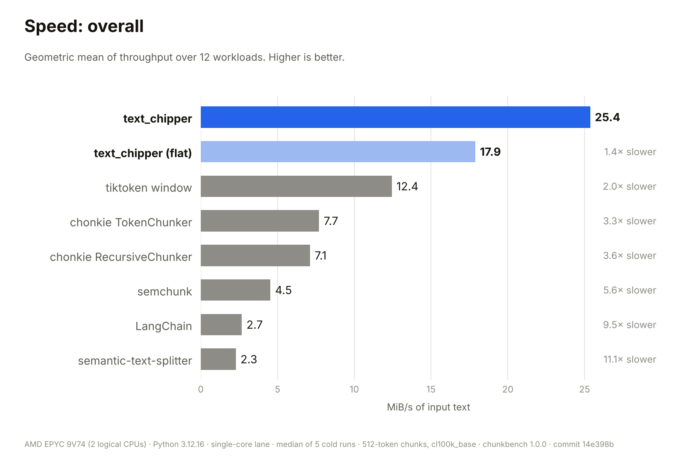
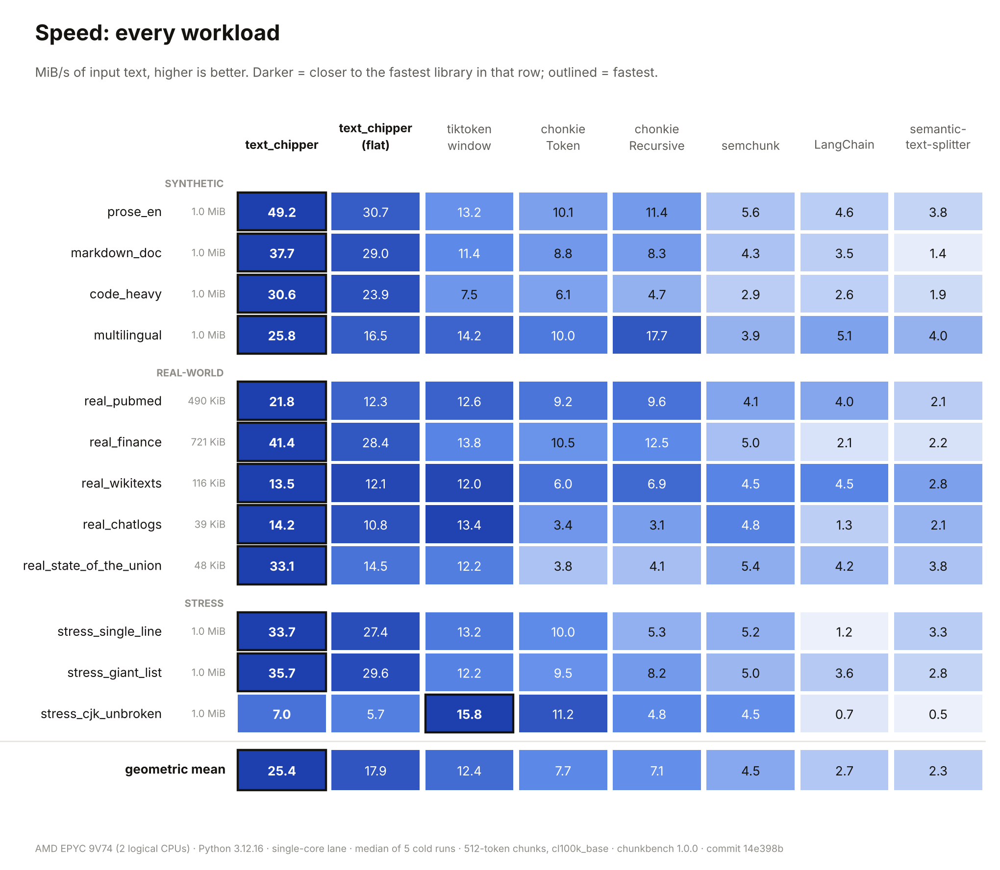
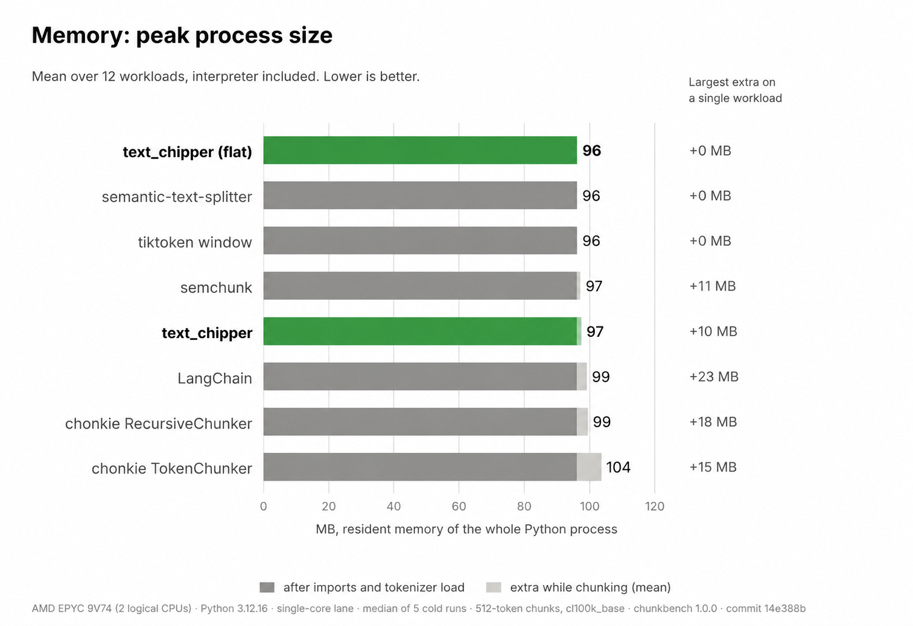
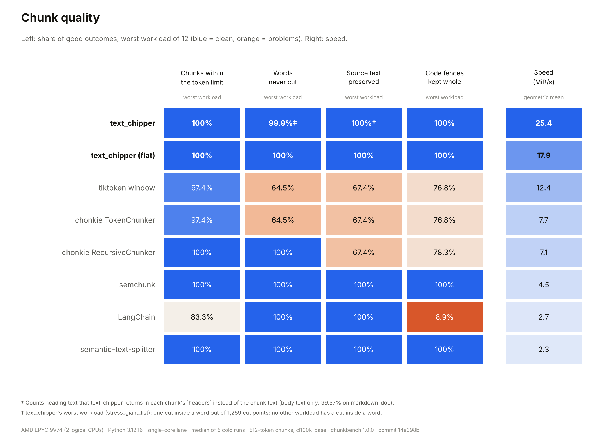

# Benchmarks

`chunkbench` is a reproducible cross-library benchmark for token-bounded text chunkers. It compares
text_chipper with seven other ways of splitting text into chunks of at most 512 `cl100k_base` tokens, on
12 workloads, and measures speed, memory, budget compliance, fidelity to the source and chunk boundary
quality.

Every number is measured from outside the libraries: chunks are located in the source text by exact
substring search and tokens are counted with one independent reference tokenizer (tiktoken `cl100k_base`).
No library's own offsets or token counts are trusted.

- [Latest results](#latest-results)
- [Run it yourself](#run-it-yourself)
- [Method](#method)
- [Contestants](#contestants)
- [Workloads](#workloads)
- [Metrics](#metrics) (definitions of every column in `report.md` and `summary.csv`)
- [Reading the coverage numbers](#reading-the-coverage-numbers)
- [Caveats](#caveats)
- [Adding a library, tests, reproducibility](#adding-a-library-tests-reproducibility)

## Latest results

Run `20261112_233503`, in [`results/20261112_233503/`](results/20261112_233503/) (full tables:
[`report.md`](results/20261112_233503/report.md), flat data: `summary.csv`, raw data: `results.json`).

| | |
| --- | --- |
| Machine | GitHub Actions runner, AMD EPYC 9V74, 2 logical CPUs, 7.7 GB RAM, Linux |
| Software | Python 3.12.16, chunkbench 1.0.0, project commit `14e398b` |
| Libraries | text-chipper 0.2.0, chonkie 1.7.0, langchain-text-splitters 1.1.3, semchunk 4.1.1, semantic-text-splitter 0.33.2, tiktoken 0.14.0 |
| Settings | 512-token chunks, `cl100k_base`, overlap 0, cold timing, 5 rounds, 1 MiB per synthetic workload |
| Size of the run | 8 contestants × 12 workloads × 2 lanes = 192 cells, 5 fresh processes each |

The charts show the `single` lane (one CPU, one thread). On this 2-CPU runner the `all` lane gives the same
picture: CPU time divided by wall time is between 1.00 and 1.10 for every library, so none of them gains
from the second CPU.

**Speed**: geometric mean of throughput over the 12 workloads.



| Library | MiB/s (geometric mean) | text_chipper is faster by |
| --- | ---: | ---: |
| text_chipper | 25.4 | |
| text_chipper (flat) | 17.9 | 1.4× |
| tiktoken window | 12.4 | 2.0× |
| chonkie TokenChunker | 7.7 | 3.3× |
| chonkie RecursiveChunker | 7.1 | 3.6× |
| semchunk | 4.5 | 5.6× |
| LangChain | 2.7 | 9.5× |
| semantic-text-splitter | 2.3 | 11.1× |



text_chipper is fastest on 11 of 12 workloads. On `stress_cjk_unbroken` tiktoken window (15.8 MiB/s) and
chonkie TokenChunker (11.2 MiB/s) are faster than text_chipper (7.0 MiB/s). On `real_chatlogs` the top two
are within noise (14.2 and 13.4 MiB/s, about 3 ms per call).

**Memory**: peak memory of the whole Python process, mean over the workloads.



**Quality**: worst case over the 12 workloads for each of four guarantees, next to speed. Chunk-end cleanliness (`clean end %`) is a style measure, not a guarantee, so it is discussed in the main README and in `report.md` instead of the scorecard.



The charts above are the summary. `python -m chunkbench plot results/20261112_233503` draws one detailed
chart per metric (workloads on the y axis, one bar per library, both lanes) into the run's `plots/` folder.

## Run it yourself

From the `benchmarks/` directory:

```bash
pip install -r requirements.txt           # contestants, psutil, matplotlib, pytest
maturin develop --release                 # text_chipper itself, run from the repository root

python -m chunkbench check                # smoke-test every adapter first
python -m chunkbench fetch                # download the real corpora, verified by SHA-256
python -m chunkbench run --rounds 5 --size-mib 1 --out results
python -m chunkbench report results/<run> # regenerate report.md and summary.csv
python -m chunkbench plot results/<run>   # detailed per-metric charts (PNG and SVG)

python make_charts.py results/<run> charts --svg   # the four README charts
```

Useful options of `run`: `--libs` and `--workloads` select a subset, `--lanes single all`, `--overlaps 0 50`
(libraries without an overlap option are skipped for overlap > 0), `--chunk-size`, `--mode steady`
(see [Method](#method)), `--no-real` (skip the downloaded corpora), `--timeout`. `python -m chunkbench run -h`
lists all of them. The defaults are 7 rounds in cold mode and 1 MiB per synthetic corpus; the published run
used 5 rounds.

`make_charts.py` needs only matplotlib and reads everything, including the environment line at the bottom of
each chart, from `results.json`.

## Method

- **Same task for everyone.** Split the input into chunks of at most 512 `cl100k_base` tokens. Libraries run
  with their defaults; nothing is tuned. Where a library has a Markdown-aware splitter it is used on the
  Markdown workloads (semantic-text-splitter `MarkdownSplitter`, LangChain `MarkdownTextSplitter`).
- **One judge.** Every chunk is re-tokenized with tiktoken `cl100k_base` on the text a library would
  actually deliver to a model (for text_chipper that is `contextualized_text`, header label included).
- **Cold timing.** Each timing sample is the first and only chunking call in a fresh Python process, on the
  unmodified text. A fresh process cannot reuse a result cache or a token-count cache, so the numbers are
  safe to quote. Import and tokenizer loading are excluded from the timing (reported as `init_ms`). The
  published number is the median over the rounds, in shuffled order so that no library always runs first or
  last. `--mode steady` instead times repeated calls and calls on salted fresh inputs; it exists to expose
  caching (a repeat speed far above the fresh speed means a cache is answering).
- **Lanes.** `single` pins the process to one CPU (where the OS supports it) and sets the thread-count
  variables (`RAYON_NUM_THREADS`, `OMP_NUM_THREADS` and others) to 1. `all` places no restriction.
- **Memory.** Peak resident memory of the process (`ru_maxrss`), read right after library import and
  tokenizer load and again after the chunking call. It includes the interpreter and everything imported.
- **No hidden work in the timed region.** Only the library's own `chunk` or `split` call is timed; turning
  its native result into strings happens afterwards.

## Contestants

| Label | What runs | Markdown-aware | Overlap |
| --- | --- | --- | --- |
| text_chipper | `TextChipper(max_length=512, encoding="cl100k_base")`, default mode (`include_context=True`, strict) | yes | yes |
| text_chipper (flat) | the same with `include_context=False`: plain token windows, no Markdown parsing | no | yes |
| chonkie TokenChunker | `chonkie.TokenChunker`, fixed token windows | no | yes |
| chonkie RecursiveChunker | `chonkie.RecursiveChunker` with its default rules | no | no |
| semantic-text-splitter | `MarkdownSplitter` or `TextSplitter` `.from_tiktoken_model("gpt-4")` (this is `cl100k_base`) | yes | yes |
| semchunk | `semchunk.chunkerify(cl100k_base, 512)`; plain text only, with its default token-count memoization | no | yes |
| LangChain | `MarkdownTextSplitter` or `RecursiveCharacterTextSplitter` `.from_tiktoken_encoder` | yes | yes |
| tiktoken window | naive baseline: encode once, slice windows of 512 tokens, decode each window | no | yes |

The adapters in [`chunkbench/adapters.py`](chunkbench/adapters.py) are the only place where a library is
configured. Review them first if you want to look for bias.

## Workloads

All synthetic corpora are generated from a seeded PRNG, so everyone is benchmarked on identical bytes. The
real corpora are downloaded once with `python -m chunkbench fetch` and pinned by SHA-256 in
[`corpora.lock.json`](corpora.lock.json).

| Workload | Kind | Format | Size | Content |
| --- | --- | --- | ---: | --- |
| `prose_en` | synthetic | plain | 1 MiB | English-like paragraphs |
| `markdown_doc` | synthetic | Markdown | 1 MiB | headings, paragraphs, bullet and numbered lists, fenced code, tables, block quotes, links |
| `code_heavy` | synthetic | Markdown | 1 MiB | about three quarters fenced code blocks (Python, JavaScript, shell) and short paragraphs |
| `multilingual` | synthetic | plain | 1 MiB | sentences in several scripts |
| `real_pubmed` | real | Markdown | 490 KiB | PubMed texts |
| `real_finance` | real | Markdown | 721 KiB | finance texts |
| `real_wikitexts` | real | Markdown | 116 KiB | Wikipedia texts |
| `real_chatlogs` | real | Markdown | 39 KiB | chat logs |
| `real_state_of_the_union` | real | Markdown | 48 KiB | a State of the Union address |
| `stress_single_line` | stress | plain | 1 MiB | the prose of `prose_en` as one line, no line breaks |
| `stress_giant_list` | stress | Markdown | 1 MiB | one huge numbered list |
| `stress_cjk_unbroken` | stress | plain | 1 MiB | Chinese and Japanese text with no separators |

The real corpora come from the `chunking_evaluation` data set
([github.com/brandonstarxel/chunking_evaluation](https://github.com/brandonstarxel/chunking_evaluation)),
which also supplies the questions whose reference excerpts are used by the answer-alignment metric. For the
synthetic workloads, excerpts of one to three consecutive sentences are sampled with a fixed seed
(`gold_source` says which kind was used).

## Metrics

Column names below are the ones in `report.md`; the matching `summary.csv` names are in parentheses where
they differ. No metric is a single score and higher is not always better: read them together.

### Speed and memory

| Column | Meaning |
| --- | --- |
| MiB/s (`mib_per_s`) | Input size in MiB divided by the median wall time of the chunking call. |
| median ms (`wall_ms_median`) | That median wall time. |
| spread % (`spread_pct`) | (max − min) / median over the rounds. A noise check: large values on calls of a few milliseconds are normal. |
| CPU ms (`cpu_ms_median`) | Median CPU time (user + system, all threads) of the call. |
| CPU/wall (`cpu_utilization`) | CPU time divided by wall time. About 1.0 means single-threaded; above 1.0 means several threads were busy. |
| RSS Δ MB (`rss_delta_mb`) | Peak resident memory after the call minus the memory right after import and tokenizer load (median over rounds): what the chunking call itself needed. |
| `rss_peak_mb`, `init_ms` | Highest peak resident memory over the rounds (whole process); import plus tokenizer load time, excluded from MiB/s. |

### Chunks and budget

| Column | Meaning |
| --- | --- |
| chunks | Number of chunks returned. |
| max tok (`tokens_max`) | Largest chunk, in reference tokens, of the delivered text. |
| over % (`over_limit_pct`) | Share of chunks above the 512-token budget. `over_limit_chunks` and `worst_overshoot_pct` give the count and the worst excess. |
| `fill_ratio`, `tokens_p5` / `p50` / `p95` | Mean fill of the budget and the token-count distribution. Higher fill means fewer chunks, not better chunks. |
| `tiny_chunk_pct` | Share of chunks (all but the last) under 10 % of the budget. |

### Fidelity: is the source preserved?

| Column | Meaning |
| --- | --- |
| located % (`located_pct`) | Share of chunks whose body is found verbatim, in order, as an exact substring of the input. A chunk that was altered, re-encoded or contains replacement characters is not located. |
| body cov % (`coverage_pct`) | Share of the input's non-whitespace characters that lie inside at least one located chunk body. |
| content cov % (`content_coverage_pct`) | Like body coverage, but a heading line missing from every body still counts as preserved when the next chunk lists its title in its `headers` metadata. The heading's own markup (`#`, setext underline) counts together with the title. Everything else that is missing stays missing. |
| `lost_nonspace_chars`, `heading_meta_chars`, `lost_unexplained_chars` | Characters missing from bodies; how many of them are carried as heading metadata; and the rest, which is really lost (`lost_unexplained = missing − carried`). |
| `duplication_pct` | Extra text caused by overlap. |
| `replacement_char_chunks` | Chunks that contain the replacement character U+FFFD although the source has none. |

### Boundary quality

| Column | Meaning |
| --- | --- |
| mid-word % (`mid_word_cut_pct`) | Share of cut positions (between neighbouring chunks) with a word character on both sides. Not defined for scripts written without spaces (CJK, Thai and others), which never count as word characters. |
| clean end % (`clean_end_pct`) | Share of chunk ends (all but the last) that follow sentence-ending punctuation or sit at a line break. A style measure, not a guarantee. |
| orphan h % (`orphan_heading_pct`) | Markdown only. Share of chunks (all but the last) whose last non-blank line is a heading, that is a heading left behind away from its section. For text_chipper headings are metadata, not body text. |
| fence ok % (`fence_intact_pct`) | Markdown only. Share of code fences that fit in half the budget and lie completely inside one chunk. `fences_measured` is how many were counted. |
| `overlap_tokens_median`, `overlap_tokens_max`, `overlap_violation_pct` | Only with overlap above 0: token overlap between neighbouring chunks, and the share above the requested overlap. |

### Answer-span alignment (an oracle proxy)

For each excerpt (a question's reference span in the real corpora, a sampled span otherwise) the benchmark
takes every chunk that touches it, as a perfect retriever would. It is not an end-to-end retrieval test.

| Column | Meaning |
| --- | --- |
| IoU (`oracle_iou_mean`) | Token overlap between the excerpt and the union of the touching chunks, divided by the token size of their union. Penalizes chunks that carry a lot of unrelated text. Values are small (about 0.1) because chunks are large compared with excerpts; only compare libraries on the same workload. |
| 1-chunk % (`single_chunk_hit_pct`) | Share of excerpts that lie completely inside one chunk. |
| `oracle_recall_mean`, `chunks_per_span_mean`, `context_tokens_per_span_mean`, `gold_source` | Share of the excerpt covered, chunks needed per excerpt, tokens a retriever would have to read, and where the excerpts came from (`dataset` or `sampled`). |

## Reading the coverage numbers

text_chipper's default mode shows **99.568 %** in `body cov %` on `markdown_doc` and 100 % in
`content cov %`. Both are correct, and they measure different things.

text_chipper does not repeat Markdown headings in the chunk body. It returns them as `headers` metadata and
as the `[ctx:A > B]` label of `contextualized_text`. In this run 3,613 non-whitespace characters of
`markdown_doc` are heading lines that appear in no chunk body. The benchmark checks each of them against the
`headers` of the first chunk that starts after the heading: all 3,613 are carried there, so
`heading_meta_chars` is 3,613 and `lost_unexplained_chars` is 0. That is the 100 % in `content cov %`.

If your pipeline only embeds `chunk.text`, headings are not part of what you embed; use
`contextualized_text` or the `headers` field to keep them. text_chipper (flat) has no header metadata and
reports 100 % in both columns. The other 11 workloads have no heading text that is missing from bodies, so
both columns read 100 % there.

For a breakdown of any run on your own file, `python diag_lost.py --size-mib 1.0` (or `--file README.md`)
sorts every missing character into `carried` (heading listed in `headers`), `heading` (heading not listed:
really lost), `fence` and `other` (really lost).

Libraries that lose text in this benchmark do so differently: tiktoken window and chonkie TokenChunker lose
32.6 % of `stress_cjk_unbroken` and 27.6 % of `multilingual`, and chonkie RecursiveChunker loses 32.6 % of
`stress_cjk_unbroken`. In all of these the affected chunks contain replacement characters (U+FFFD) instead
of the original text, which `located %` and `replacement_char_chunks` show.

## Caveats

- **One run on a shared virtual machine.** The load average was 1.3 when the run started and no run was
  repeated. Treat ratios as indicative. The small corpora (`real_chatlogs`, `real_state_of_the_union`,
  `real_wikitexts`) take only a few to a few tens of milliseconds per call, where a single slow process moves the median; the `spread %`
  column shows it (up to 534 % for one 1.4 ms cell).
- **Python entry points only.** The timed call is the library's Python API, including the boundary to native
  code where a library has one. Results for other languages or the Rust API are not covered.
- **Defaults everywhere.** Nothing is tuned for any library, and a tuned configuration of another library may
  differ. Overlap above 0 is supported by the harness but was not part of the published run.
- **Chunk quality is not retrieval quality.** The metrics describe chunk boundaries and fidelity. The
  answer-alignment numbers are an oracle proxy; no embedding model or retriever was evaluated.
- **Header context counts against text_chipper's budget.** The delivered text includes the `[ctx:...]` label,
  and it is within 512 tokens. The other libraries have no such label.
- **The tiktoken window is a baseline,** not a recommended chunker. It is in the table to show what
  token-exact windows cost and what they break.

## Adding a library, tests, reproducibility

- **Add a library:** add one `Adapter` to `chunkbench/adapters.py`, following the rules in the module
  docstring, and run `python -m chunkbench check`.
- **Self-tests of the harness:** `pytest benchmarks/tests -q` from the repository root. They use stub
  contestants and a crude tokenizer, never for published numbers.
- **Reproducibility:** synthetic corpora use a fixed seed (`--seed 20260101`), real corpora are verified by
  SHA-256, and `results.json` records the exact library versions, Python version, CPU, commit and arguments.
  Keep `pip_freeze.txt` and `commit.txt` next to a published run.
- **Other scripts:** `diag_lost.py` explains missing characters (see above); `diag_real.py` shows first-call,
  repeated-call and fresh-text timings per corpus, and with a `stats` build (`maturin develop --release
  --features stats`) the tokenizer calls per call site.
