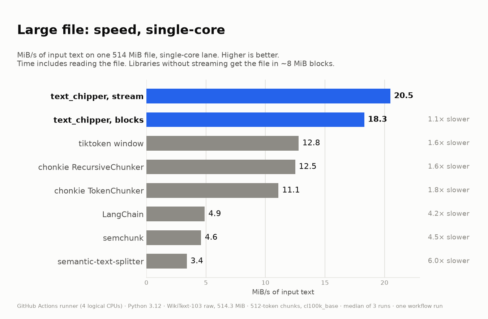
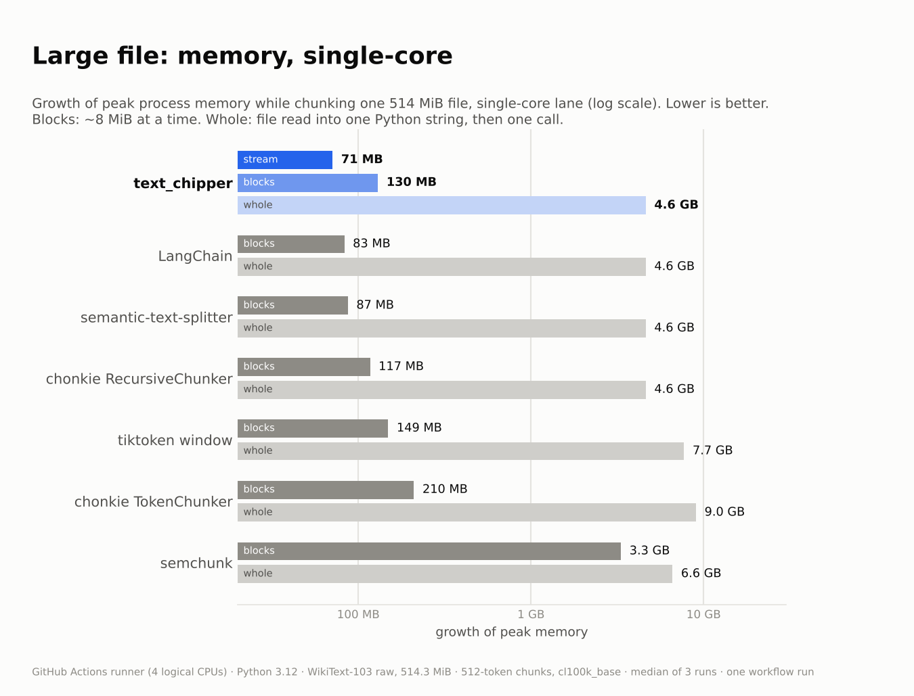
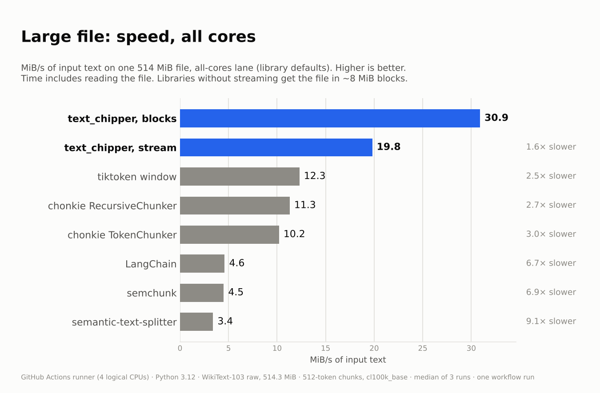
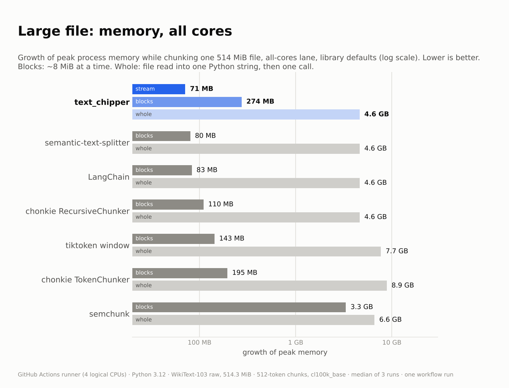

# Benchmarks

Two benchmarks live here, plus two smaller checks below (replacement characters and a real README). Both compare text_chipper with the same libraries (chonkie, langchain-text-splitters,
semchunk, semantic-text-splitter and a plain tiktoken token window), configured by the same adapters in
[`chunkbench/adapters.py`](chunkbench/adapters.py), at 512 tokens with `cl100k_base`.

| Benchmark | Question | Entry point | Results |
| --- | --- | --- | --- |
| Main harness | Speed, memory and chunk quality over 12 workloads of up to about 1 MB | `python -m chunkbench` | [`results/20261113_213722/`](results/20261113_213722/) |
| Large file | What happens on one 514 MiB file, and what does streaming change? | [`streaming_bench.py`](streaming_bench.py) | [`results/streaming_20261114/`](results/streaming_20261114/) |

The charts used in the main README are in [`charts/`](charts/).

## Main harness

```bash
pip install -r requirements.txt
python -m chunkbench check     # are all libraries importable?
python -m chunkbench fetch     # download the real corpora once
python -m chunkbench run       # run the workloads (see --help for lanes, rounds and workloads)
python -m chunkbench report results/<run>
python -m chunkbench plot results/<run>
```

Each run writes a folder under `results/` with `results.json`, `report.md`, `pip_freeze.txt` and `commit.txt`.
`report.md` explains how to read the numbers. Lanes: `single` pins the process to one CPU and sets the thread
variables to 1, `all` applies no restriction.

## Large-file benchmark

[`streaming_bench.py`](streaming_bench.py) chunks one big file. One run is one mode in one fresh process:

| Mode | What it does |
| --- | --- |
| `text_chipper:stream` | `TextChipper.from_file_stream(path)`, chunks consumed one at a time |
| `<adapter>:whole` | read the whole file into one string, call the library once |
| `<adapter>:blocks` | give the library blocks of about 8 MiB cut at line boundaries (one call per block) |

`<adapter>` is a name from `chunkbench.adapters.ADAPTERS` (`text_chipper`, `tiktoken_window`, `chonkie_token`,
`chonkie_recursive`, `semchunk`, `semantic_text_splitter`, `langchain`). `text_chipper:stream` exists only for
`text_chipper`.

What is measured:

- **Time:** end to end for the chunking work, including reading the file. Verification is not timed.
- **Memory:** growth of the process's peak memory after warm-up (library imported, tokenizer loaded). Memory comes
  from runs without `--verify`, because verification builds extra objects.
- **Verification (`--verify`):** counts the tokens of every delivered chunk with the reference tokenizer and hashes the
  delivered text. Identical hashes mean identical chunks.
- **Lanes:** `--lane single` (default: one CPU, thread variables 1) or `--lane all`.

Run it on your machine:

```bash
python benchmarks/prepare_corpus.py corpus.txt           # WikiText-103 raw, prints size and SHA-256
python benchmarks/streaming_bench.py corpus.txt --mode text_chipper:stream --lane single
python benchmarks/streaming_bench.py corpus.txt --mode langchain:blocks --lane single --verify
```

The GitHub Actions workflow [`streaming-bench.yml`](../.github/workflows/streaming-bench.yml) runs every mode in both
lanes on separate runners. Inputs: `modes` (`chipper`, `blocks` or `all`), `max_mib` (use only the first N MiB of the
corpus, 0 = full), `rounds` (timed runs per mode, default 3, plus one verify run) and `timeout_s`. Then:

```bash
python benchmarks/summarize_streaming.py results.jsonl          # Markdown table
python benchmarks/plot_streaming.py results/streaming_<date>/*.jsonl   # charts into benchmarks/charts/
```

### Latest results (514.3 MiB)

See [`results/streaming_20261114/summary.md`](results/streaming_20261114/summary.md) for both lanes and every mode,
and the "Large files and streaming" section of the main README for the discussion.

Single-core lane:





All-cores lane:





## Replacement characters (U+FFFD)

[`cjk_loss_check.py`](cjk_loss_check.py) counts chunks that contain U+FFFD and the characters that actually disappear.
`loss_report(source, chunks)` removes U+FFFD from the joined chunks and compares the remaining non-whitespace characters
with the source.

- The check is valid for splitters whose chunks are non-overlapping and contain the source text. It is **not** valid for
  text_chipper's default mode, because headings are returned in `headers` and are not in the chunk body.
- The main README's coverage metric is stricter than this. A chunk that contains U+FFFD cannot be matched verbatim, so the
  whole chunk leaves coverage. That is why coverage reports 32.6 % loss for the CJK workload while far fewer characters
  disappear.
- Bound: a cut point can destroy at most one character, so the characters lost are at most the number of damaged chunks.

| Input | Splitter | Chunks with U+FFFD | Characters lost |
| --- | --- | ---: | ---: |
| CJK workload of the main harness | tiktoken window | 245 of 751 | at most 245 (under 0.1 %), upper bound, not measured |
| Synthetic CJK file, about 1.7 M characters | tiktoken window | 546 of 2,833 | 286 (0.017 %) |
| Same synthetic file | text_chipper flat mode | 0 | 0 |

## Before and after on a real README

[`before_after_readme.py`](before_after_readme.py) chunks one Markdown file with a fixed token window and with text_chipper
(default mode), then writes both outputs to a report and counts chunks that split a code fence or contain U+FFFD.

```bash
python benchmarks/before_after_readme.py README.md --max-tokens 256 --out report.md
```

- Fence detection checks the chunk body. A chunk that lies entirely inside a code block, with no fence marker, is not flagged.

## Install footprint

Dependencies, installed size and startup time, measured outside the harness (macOS arm64, Python 3.15, one
measurement per library). The numbers are in the main README under "Install size and startup".

```bash
# One empty virtual environment per library, then count packages and measure the size
python3 -m venv /tmp/empty && du -sk /tmp/empty/lib/python*/site-packages | cut -f1     # baseline in KB
for p in chonkie langchain-text-splitters semchunk semantic-text-splitter tiktoken; do
  python3 -m venv /tmp/c_$p && /tmp/c_$p/bin/pip install -q $p
  echo "$p: $(/tmp/c_$p/bin/pip list --format=freeze | grep -vc '^pip==') packages (including itself)," \
       "$(du -sk /tmp/c_$p/lib/python*/site-packages | cut -f1) KB"
done

# import time (run each twice and read the second; the first can include one-off system checks)
/tmp/c_chonkie/bin/python -c "import time; t=time.perf_counter(); import chonkie; print(round(1000*(time.perf_counter()-t)), 'ms')"

# import + tokenizer load + first chunk, through the benchmark adapters (from the benchmarks/ folder)
python3 -c "
import time
t = time.perf_counter()
from chunkbench import adapters
r = adapters.ADAPTERS['text_chipper'].build(adapters.Ctx(512, 0, 'plain', 'cl100k_base'))
r.run('# Title\n\nSome text.\n')
print(round(1000 * (time.perf_counter() - t)), 'ms')
"
```

The size of the text_chipper wheel is the size of the file `pip download text-chipper --no-deps` saves.

### Limits

- One workflow run per lane on shared virtual machines. The two lanes ran on different machines, so do not compare lanes
  for single-threaded modes. Treat ratios as indicative.
- Block mode is our choice of how to feed a string-only library; chunks at block edges can differ from a one-call run.
- In whole-file mode the memory peak is dominated by reading the file into a Python string, which every library pays.
- Retrieval quality is not measured.
